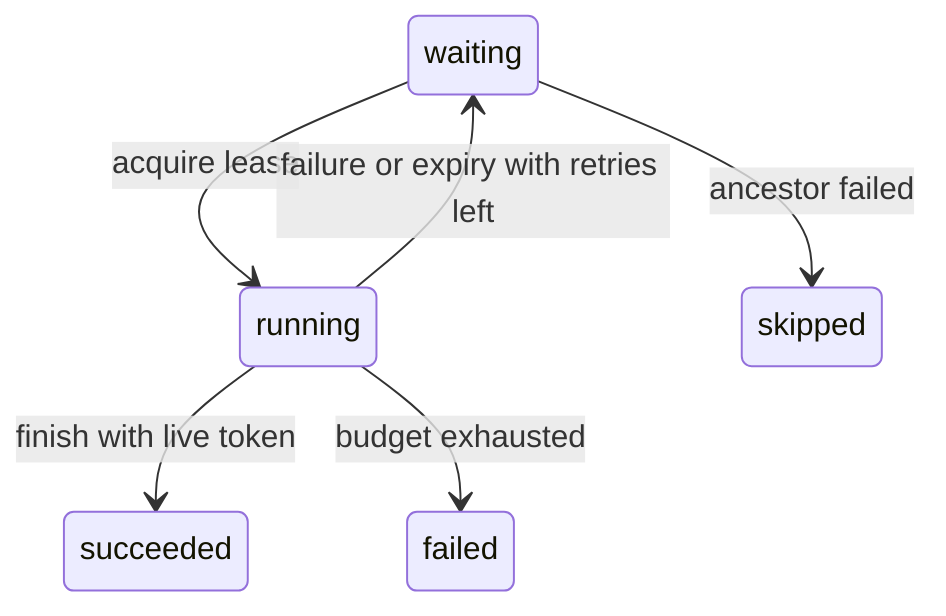

# Switchyard Flow

Switchyard is a durable workflow scheduler for jobs with dependencies. Independent Python processes share a SQLite database, acquire time-limited leases, and pass completed JSON results to downstream jobs. A worker can disappear between claiming a task and reporting success.

## Try a fan-out and join

Python 3.9+ with SQLite. Run these commands from the checkout:

```sh
python3 -m switchyard demo.db pool readers 2
python3 -m switchyard demo.db submit harbor examples/word-count.json
python3 -m switchyard demo.db work laptop --until-idle
python3 -m switchyard demo.db status harbor
python3 -m switchyard demo.db events harbor --after 0
```

The two readers count words separately, the city job merges their results, and the final job emits `[["blue", 3], ["ferry", 3]]`. Submitting the same run ID and definition again returns `{"created": false}`. Start additional workers in other terminals to share the work. Omit `--until-idle` to poll for retries and future jobs.

## Ownership and failure semantics



Each claim takes a short SQLite write transaction. It expires dead attempts, checks dependencies and capacity across all runs, and issues a unique attempt token. Heartbeats, completion, and failure all compare the token and the expiry inside the same transaction as the update. At the exact expiry time, the old worker loses ownership. Events and state commit together.

The handler executes outside the transaction. The standard worker renews its lease every third of its TTL. A crash after an external side effect and before completion can repeat the effect. An external API can deduplicate using the stable pair `(lease.run_id, lease.name)`. The attempt token changes on retry. Expired attempts are reaped on the next claim. The retry delay doubles from one second up to sixty seconds. Final failure skips descendants, while independent branches may finish.

## Add a handler

```python
from switchyard import Engine
from switchyard.worker import execute

engine = Engine("custom.db")
engine.submit("temperature-001", {"jobs": {"average": {
    "kind": "mean", "payload": [22, 25, 19], "max_attempts": 2
}}})
lease = engine.claim("sensor-worker")
if lease:
    execute(engine, lease, {"mean": lambda task: sum(task.payload) / len(task.payload)})
print(engine.report("temperature-001")["jobs"]["average"]["result"])
```

Handlers receive their own payload and a mapping of prerequisite names to results. A pool defaults to capacity one. Lowering a pool limit lets existing leases finish and blocks new claims until capacity is available.

## Operating envelope

Use a single host and a local filesystem compatible with SQLite WAL. All workers share the host clock. A wall-clock jump changes when leases expire. SQLite serializes write transactions, which favors short state transitions and longer application work. Jobs, results and events remain in the database. Polling claim throughput, payload size, and history retention should be evaluated for the workload.

## Verification

```sh
python3 -m unittest discover -s tests -v
```

The suite races submitters and claimers, kills a real worker process, reopens a database between attempts, checks fencing at the expiry boundary, and runs the public CLI through the sample workflow.
